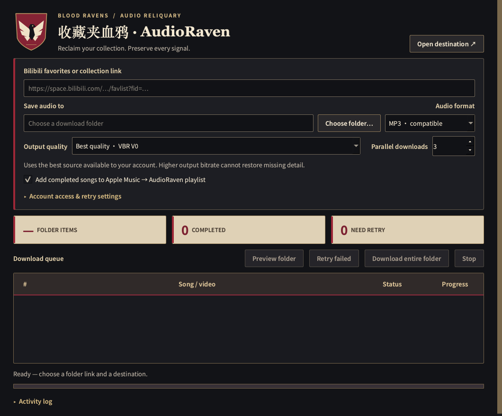

# AudioRaven · 收藏夹血鸦

English | [简体中文](README.zh-CN.md)

A desktop app for **Windows and macOS** that saves audio from a Bilibili favorites folder, collection, or video. Paste a link, choose a destination, and download the batch. Python, the download engine, and FFmpeg are included in packaged releases. BilibiliDown and Java are not required.

The interface uses a Blood Ravens inspired crimson, bone, and brass archive theme.



AudioRaven was previously named BiliSong. Existing files are preserved. On first
launch, the app can reuse the previous build's local preferences and completed
download/Music records. The new Apple Music playlist is named **AudioRaven**.

## Downloads and platform support

Open this repository's **Releases** section and choose the ZIP for your system. Extract it completely before opening the app.

| System | Package | Launch |
| --- | --- | --- |
| Windows 11, Intel/AMD 64-bit | `AudioRaven-0.3.0-Windows-amd64.zip` | Extract all files; open `AudioRaven/AudioRaven.exe` |
| macOS 15+, Apple Silicon | `AudioRaven-0.3.0-macOS-arm64.zip` | Open `AudioRaven.app`; optionally copy to Applications |
| macOS 15+, Intel | `AudioRaven-0.3.0-macOS-x86_64.zip` | Open `AudioRaven.app`; optionally copy to Applications |

These are separate native builds, not a universal binary. Windows ARM64 and 32-bit Windows are not currently release targets. Windows 10 and older macOS versions are not part of the validation matrix.

**Validation status:** macOS can be tested locally. Windows support must pass the native Windows CI job and packaged smoke checks before a Windows binary is released. A CI pass does not guarantee every PC, browser cookie store, or Bilibili account will work. See [compatibility and troubleshooting](docs/COMPATIBILITY.md).

The app is unsigned and the Mac build is not notarized. Windows or macOS may show an unknown-publisher warning. Verify the release source and SHA-256 checksums before deciding whether to open it. Do not disable system security protections.

## Open the app

After building locally, open `dist/AudioRaven.app` on macOS or `dist/AudioRaven/AudioRaven.exe` on Windows. Keep the Windows executable together with its `_internal` directory.

To run from source instead, use Python 3.12–3.14 (CI uses 3.12):

```sh
python3 -m venv .venv
.venv/bin/python -m pip install -r requirements.txt
.venv/bin/python scripts/fetch_font.py
.venv/bin/python main.py
```

On Windows, use PowerShell (activation is not required):

```powershell
py -3.12 -m venv .venv
.\.venv\Scripts\python.exe -m pip install -r requirements.txt
.\.venv\Scripts\python.exe scripts/fetch_font.py
.\.venv\Scripts\python.exe main.py
```

## Download a folder

1. Paste the URL of a specific Bilibili favorites folder or creator collection. Favorites links normally include a folder ID, for example `https://space.bilibili.com/12345/favlist?fid=67890`.
2. Choose the destination directory.
3. Choose MP3, then select Best quality (VBR V0), 320, 256, 192, or 128 kbps. Best is the default; an already-MP3 source is preserved in Best mode, while explicit bitrates are re-encoded. M4A copies AAC sources without re-encoding, or converts other source codecs to AAC at 320 kbps.
4. On macOS, leave automatic Music import enabled to add completed audio to the Music app's **AudioRaven** playlist, or turn it off to download files only. On Windows, open the saved files with your preferred music player; automatic Apple Music import is not available.
5. Set Parallel downloads from 1 to 6 (default 3), then start the batch. The app first collects the folder entries across all pages, then downloads up to that many items simultaneously. A failed entry does not stop the remaining batch. Music imports use a separate serial queue, so they do not occupy download slots.
6. Review the queue when the batch finishes. Retry failed entries after fixing any connection or login problem.

The app also accepts supported individual Bilibili video links. For account favorites, use a specific folder link instead of your account's profile URL. A folder may contain removed, private, or otherwise unavailable videos; these cannot be made downloadable by retrying.

The app selects yt-dlp's best available audio source, falling back to combined video/audio when necessary. Account access can affect the available source formats. Output quality controls conversion; a larger bitrate cannot restore detail missing from the source. Best MP3 uses VBR quality 0, not a promise of lossless audio. The activity log shows source codec and approximate bitrate when available. The earlier 0.1 release preferred M4A sources and used a fixed 192 kbps MP3 conversion.

## Account access

Public folders can work without signing in. If Bilibili requires login, use the app's optional account settings to select a supported browser where you are already signed into Bilibili, or select a Netscape-format cookies file exported from your own account. A browser's cookie storage may be locked or protected by macOS; a cookies file is the alternative when automatic browser access fails.

Cookies are used locally to authenticate requests to Bilibili. Do not share a cookies file or add it to version control. The app does not ask for your Bilibili password. Expired cookies need to be refreshed by signing into Bilibili again. Browser encryption or a locked profile can prevent automatic cookie access on Windows; an exported Netscape-format cookies file is the fallback. Safari is offered only on macOS.

## Import into Apple Music

Automatic import adds local downloaded MP3 or M4A files to your Music library and its **AudioRaven** playlist. On the first import, macOS may ask whether AudioRaven can control Music. Allow access to use this feature. If permission was denied, it can be changed in System Settings → Privacy & Security → Automation.

The app stores returned Music track IDs in `.audioraven-music.json` in the download destination and checks them on later imports to avoid adding the same downloaded file repeatedly. Keep that record if you want repeated runs to recognize earlier imports. Music may copy files into its own media folder according to its settings. An import problem leaves downloaded files intact; Music setup or automation prompts may need attention before retrying.

## Reliability and saved files

- Request timeout limits a stalled network request. Per-item timeout also limits the complete download/conversion attempt, including an unresponsive converter.
- Retries use increasing delays and are bounded. A retry count of 3 means up to 4 attempts including the initial attempt. An exhausted item becomes failed and the rest of the queue continues.
- Stop cancels every active download and converter, and prevents queued downloads/imports from starting. A later run can reuse partial downloads where the server supports resuming.
- Audio files are saved beneath the selected destination in folders such as `mp3/best/`, `mp3/320/`, or `m4a/source/`. Different quality versions are kept separately. Existing files, including older 192 kbps downloads, are preserved. Download history includes the selected quality, so a lower-quality file is never treated as an upgraded output. The 0.2 source-selection policy starts fresh history entries rather than assuming older outputs match it.
- Completed files retain readable titles and stable identifiers to avoid collisions. Repeating a batch at the same quality skips output when all recorded files still exist and are nonempty.
- A `.audioraven-report.json` file in the destination records the latest batch results.
- Unfinished downloads and conversions stay in `.audioraven-work/`. Successful conversion output is published to the format folder without replacing an existing different file.

Collection listings depend on Bilibili's current site behavior and yt-dlp's support. An account-specific full download must be verified with a real folder link and any required login.

## Development and packaging

```sh
.venv/bin/python -m pip install -r requirements-dev.txt
.venv/bin/python -m pytest -q
.venv/bin/python build_app.py --archive
.venv/bin/python scripts/check_package.py
```

On Windows, replace `.venv/bin/python` with `.\.venv\Scripts\python.exe`.

The tests exercise local queue, retry, timeout, cancellation, and validation behavior without downloading someone else's collection. Packaging uses PyInstaller and includes yt-dlp's dynamically loaded extractors and imageio-ffmpeg's FFmpeg binary. Build natively on each target OS and CPU architecture. [PyInstaller cannot cross-compile these apps](https://pyinstaller.org/en/stable/).

## Privacy, contributing, and license

No analytics or crash-upload service is configured. Preferences (including your last URL and local paths) are saved locally through Qt; reports and history are saved in your chosen download destination. Session cookies authenticate requests to Bilibili. See [Privacy](docs/PRIVACY.md) before sharing logs or screenshots.

Original AudioRaven code is licensed under [MIT](LICENSE). Bundled dependencies keep their own licenses; see [Third-party notices](THIRD_PARTY_NOTICES.md). Download only content you have permission to save, and follow the site's terms and applicable law. This project is not affiliated with Bilibili or Apple.

- [Development and native builds](docs/DEVELOPMENT.md)
- [Compatibility and troubleshooting](docs/COMPATIBILITY.md)
- [Release checklist and GitHub contents](docs/RELEASING.md)
- [Contributing](CONTRIBUTING.md) · [Security](SECURITY.md) · [Changelog](CHANGELOG.md)

If a Bilibili site change breaks extraction, update the pinned yt-dlp version in `requirements.txt`, install it, re-test, and rebuild the app. Upstream reference: [yt-dlp documentation](https://github.com/yt-dlp/yt-dlp#readme).
