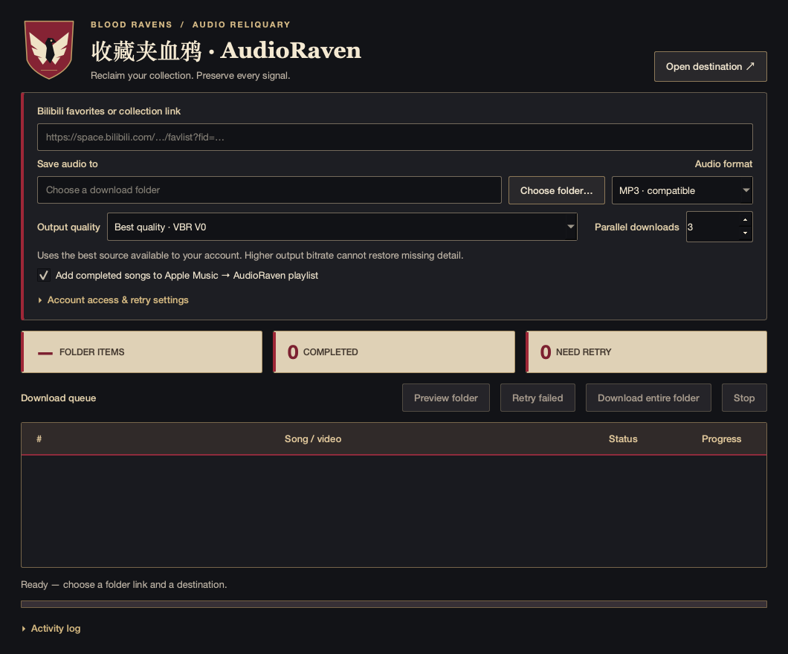

# 收藏夹血鸦 · AudioRaven

[English](README.md) | 简体中文

将哔哩哔哩收藏夹、合集或视频中的音频保存到本地的 **Windows / macOS 桌面应用**。粘贴链接、选择保存目录，即可批量下载。发行包内含 Python、下载引擎和 FFmpeg，无需安装 Java 或 BilibiliDown。

界面采用血鸦风格的暗红、骨白与黄铜色档案终端设计。



AudioRaven 原名 BiliSong。已有音频文件会保留；首次启动时可沿用旧版的本地设置、已完成下载记录与 Music 导入记录。新版 Apple Music 播放列表名为 **AudioRaven**。

## 下载与系统支持

在本仓库的 **Releases（发行版）** 中选择适合系统的 ZIP，完整解压后再打开应用。

| 系统 | 文件名 | 打开方式 |
| --- | --- | --- |
| Windows 11，Intel / AMD 64 位 | `AudioRaven-0.3.0-Windows-amd64.zip` | 完整解压，打开 `AudioRaven/AudioRaven.exe` |
| macOS 15 及以上，Apple Silicon | `AudioRaven-0.3.0-macOS-arm64.zip` | 打开 `AudioRaven.app`，也可复制到“应用程序” |
| macOS 15 及以上，Intel | `AudioRaven-0.3.0-macOS-x86_64.zip` | 打开 `AudioRaven.app`，也可复制到“应用程序” |

各平台使用独立原生构建，并非通用二进制包。暂不发行 Windows ARM64 或 32 位版本；Windows 10 和较早的 macOS 不在当前验证范围内。

**验证范围：** macOS 可在本机验证。Windows 发行包必须先通过 Windows 原生 CI 测试和打包应用检查。CI 通过不代表每台电脑、每种浏览器 Cookie 存储或每个 B 站账号都一定可用。详见[兼容性与故障排查](docs/COMPATIBILITY.zh-CN.md)。

应用未进行发行者签名，Mac 版也未经 Apple 公证。系统可能提示未知发行者；请核实下载来源与 SHA-256 校验值后，自行决定是否打开，不要关闭系统安全防护。

## 从源码运行

使用 Python 3.12–3.14；CI 使用 3.12。

macOS：

```sh
python3 -m venv .venv
.venv/bin/python -m pip install -r requirements.txt
.venv/bin/python main.py
```

Windows PowerShell，无需激活虚拟环境：

```powershell
py -3.12 -m venv .venv
.\.venv\Scripts\python.exe -m pip install -r requirements.txt
.\.venv\Scripts\python.exe main.py
```

本地打包后，Mac 打开 `dist/AudioRaven.app`；Windows 打开 `dist/AudioRaven/AudioRaven.exe`，并保留其旁边的 `_internal` 文件夹。

## 下载收藏夹

1. 粘贴某个具体收藏夹或 UP 主合集的链接。收藏夹链接通常带有 `fid=`，例如 `https://space.bilibili.com/12345/favlist?fid=67890`。不要只粘贴个人主页地址。
2. 选择音频保存目录。
3. 选择 MP3 或 M4A。MP3 可选 Best（VBR V0，默认）、320、256、192 或 128 kbps。Best 模式保留已经是 MP3 的源文件；指定码率会重新编码。M4A 对 AAC 源直接封装，其他编码则转为 320 kbps AAC。
4. macOS 可勾选自动导入 Apple Music 的 **AudioRaven** 播放列表；取消勾选即可仅保存文件。Windows 没有自动导入功能，请用喜欢的播放器打开已保存音频。
5. 并行下载数可设为 1–6，默认 3。应用先读取整个列表，再按并行数下载；单个条目失败不会中止整个队列。Music 导入使用独立的串行队列，不占下载名额。
6. 完成后检查失败条目，解决网络或登录问题后重试。

也支持提取器支持的单个 B 站视频链接。已删除、无权限或其他不可用视频，不能仅靠重试恢复。

应用选择 yt-dlp 能获取的最佳音频源，必要时使用同时含音视频的格式。账号权限可能影响可用格式。输出码率不能补回源文件缺失的细节；Best MP3 不等于无损。活动日志在有信息时显示源编码和大致码率。较早的 0.1 版偏好 M4A 源，并固定转换为 192 kbps MP3。

## 账号访问

公开内容可能无需登录。需要登录时，可选择已登录 B 站的浏览器，或选择由自己账号导出的 Netscape 格式 Cookie 文件。浏览器加密、文件锁定或系统权限可能阻止自动读取；此时可改用导出的 Cookie 文件。Safari 选项仅在 macOS 显示。

Cookie 在本机读取，并用于向 B 站发起身份验证请求。不要分享 Cookie 文件或将其提交到 Git。应用不会询问 B 站密码。Cookie 失效后需重新登录并更新。

## 导入 Apple Music（仅 macOS）

自动导入将下载完成的 MP3 / M4A 加入本地 Music 资料库和 **AudioRaven** 播放列表，无需 Apple Music 订阅。首次导入时，macOS 可能询问是否允许控制 Music；可在“系统设置 → 隐私与安全性 → 自动化”中管理此权限。

应用在下载目录的 `.audioraven-music.json` 中保存 Music 返回的曲目标识，后续检查这些标识以减少重复导入。保留此记录。Music 是否复制音频到自己的媒体目录，取决于 Music 设置。导入失败时，下载的文件仍会保留。

## 可靠性与本地记录

- 网络超时限制单次请求；每项时间上限覆盖完整的下载与转换，包括无响应的转换器。
- 重试有上限，间隔逐步增加。重试数为 3 表示初次尝试后最多再试 3 次。重试耗尽后标为失败，其余条目继续。
- Stop 会停止活动中的下载和转换器，并阻止排队任务继续。服务器支持时，下次可续传未完成下载。
- 音频按格式和质量保存到 `mp3/best/`、`mp3/320/`、`m4a/source/` 等目录。不同质量分别保存；旧文件不会被替换。较低质量文件不会被当作已完成的高质量版本。
- 文件名保留可读标题和稳定标识，减少重名。相同质量再次运行时，仅在记录的文件都存在且非空时跳过。
- `.audioraven-report.json` 记录最近一批结果；`.audioraven-completed.json` 保存已完成历史。
- 未完成下载和转换留在 `.audioraven-work/`。转换成功后才发布到格式目录，不覆盖内容不同的已有文件。

列表提取依赖 B 站当前行为和 yt-dlp 支持情况。具体账号的完整下载仍需用获授权的真实链接和所需登录进行验证。

## 开发与打包

```sh
.venv/bin/python -m pip install -r requirements-dev.txt
.venv/bin/python -m pytest -q
.venv/bin/python build_app.py --archive
.venv/bin/python scripts/check_package.py
```

Windows 请把 `.venv/bin/python` 换成 `.\.venv\Scripts\python.exe`。

测试使用合成音频和模拟网络边界，覆盖队列、重试、超时、取消和输入验证。各系统与 CPU 架构需分别原生打包；[PyInstaller 不支持这里所需的跨平台编译](https://pyinstaller.org/en/stable/)。B 站改版导致提取失效时，应更新 `requirements.txt` 中锁定的 yt-dlp 版本，重新测试并打包。

## 隐私、贡献与许可

应用没有配置分析统计或崩溃自动上传服务。本地 Qt 设置保存最近的链接、目录和偏好；下载报告与历史保存在所选目录。分享日志或截图前请阅读[隐私说明](docs/PRIVACY.zh-CN.md)。

AudioRaven 原创代码采用 [MIT 许可证](LICENSE)，可参考[中文译文](LICENSE.zh-CN.md)。依赖保留各自许可证，见[第三方声明](THIRD_PARTY_NOTICES.zh-CN.md)。请仅保存有权下载的内容，并遵守网站条款与适用法律。本项目与哔哩哔哩或 Apple 无隶属关系。

- [开发与原生构建](docs/DEVELOPMENT.zh-CN.md)
- [兼容性与故障排查](docs/COMPATIBILITY.zh-CN.md)
- [GitHub 内容与发行清单](docs/RELEASING.zh-CN.md)
- [参与贡献](CONTRIBUTING.zh-CN.md) · [安全说明](SECURITY.zh-CN.md) · [更新记录](CHANGELOG.zh-CN.md)
